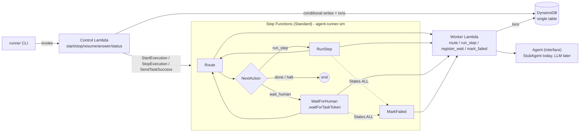
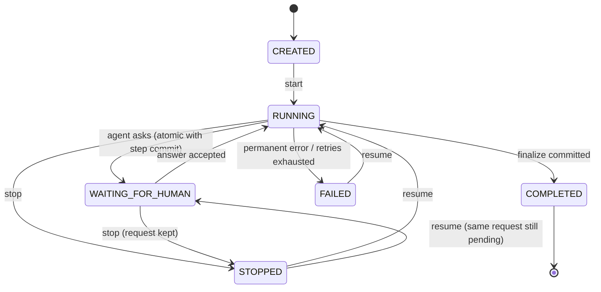

# Design Document

## 1. Summary

A pausable agent runner. A run walks a small pipeline (`validate_input → agent_decision → [human_approval] → finalize`);
the agent step may decide it needs a human, at which point the run **parks durably** with zero compute and a
discoverable `request_id`. The key idea: **DynamoDB is the single source of truth and Step Functions is just a
disposable executor.** The state machine is a 4-state loop (`Route → RunStep | WaitForHuman → Route`) that asks the
engine "what next?" by reading DynamoDB, so *start*, *resume after stop* and *resume after failure* are literally the
same code path, and a stopped run can be continued in a brand-new execution. Idempotency comes from putting each
step's result, the pointer advance, the status change and any side effect into **one DynamoDB transaction** guarded by conditions.

## 2. Architecture



| Component | Why |
|---|---|
| **Step Functions Standard** | Durable timers/callbacks for up to a year; `waitForTaskToken` pauses with no compute and no polling; built-in Retry/Catch; free tier covers 4k transitions/month. |
| **DynamoDB (on-demand, single table)** | Source of truth for runs/steps/requests/effects/events. Conditional writes and `TransactWriteItems` give atomic, idempotent state changes with no servers; pay-per-request ≈ $0 at this scale. |
| **Lambda ×2** | `Worker` = executes steps (called by the state machine). `Control` = operator API (called by the CLI). Same zero-dependency code package. |
| **CDK (Python)** | Same language as the app; `make deploy` / `make destroy`. |

Code seams: `pipeline.py` (pure steps) · `agent.py` (agent interface) · `engine.py` (orchestration rules) · `store.py` (all DynamoDB) ·
`orchestrator.py` (port with `StepFunctionsOrchestrator` and `LocalOrchestrator`).

**Table layout** (`PK = RUN#<id>`): `META` (status, pointer `current_step`, `input`, `context`, `attempt`, `version`, `pending_request_id`, `error`) ·
`STEP#<id>` (status, result, invocations) · `REQ#<request_id>` (question, status, decision, task_token) · `EFFECT#<step>` (the recorded side effect) ·
`EVT#<time>#<rand>` (history, written in the same transaction as the change it records).

## 3. Run and step state model



* The table lives in `models.TRANSITIONS`; every status write is `UpdateItem … ConditionExpression status IN (allowed sources)`.
  `allowed_sources(target)` is derived from the table, so code can't drift from it. `COMPLETED` is terminal.
* **Step states**: `STARTED` (an invocation began; counted in `invocations`) → `DONE` (result committed). A run-level
  **pointer** `current_step` says which step is next; it advances in the same transaction as the step's `DONE`.
  `human_approval` is a logical step: only entered when the agent asks, marked `DONE` by the answer transaction,
  shown as `SKIPPED` otherwise.
* **Request states**: `PENDING → ANSWERED` (conditional).
* Where state lives: *only* DynamoDB. The execution input is just `{run_id}`. A Lambda or CLI restart loses nothing.

## 4. Control operations

### 4.1 Human-in-the-loop
1. `agent_decision` returns `HumanInput`. In **one transaction** the engine commits: step `DONE` + `REQ#<request_id>` (`PENDING`, question, options) +
   run → `WAITING_FOR_HUMAN` with `pending_request_id` + pointer → `human_approval` + events.
   `request_id = "req-" + sha256(run_id/step_id)[:10]` - stable, so concurrent workers agree; never derived from question text.
2. `Route` sees `WAITING_FOR_HUMAN` → `WaitForHuman` runs `register_wait`, which stores the **task token** on the REQ item and returns.
   The execution now sleeps inside Step Functions: no Lambda, no polling.
3. `runner status|pending` expose the pending request (the token is never returned).
4. `answer(run_id, request_id, decision)`: validates the id, then one transaction does REQ `PENDING→ANSWERED` + run `WAITING→RUNNING`
   (only if `pending_request_id` matches) + pointer → `finalize` + `human_approval` step `DONE` + event. The winner calls `SendTaskSuccess` with the stored token.
5. *Race*: if the answer lands before the token is registered, `deliver` finds no token and returns; `register_wait` re-reads the
   request, sees `ANSWERED`, and wakes the execution itself.

### 4.2 Stop
One conditional transition `RUNNING|WAITING_FOR_HUMAN → STOPPED` (so `STOPPED→STOP`, `COMPLETED→STOP`, `FAILED→STOP` are rejected), then `StopExecution` on the current attempt's execution.
`pending_request_id` and the REQ item are untouched. **Stop mid-step**: an in-flight Lambda may still finish, but its commit transaction requires `run.status = RUNNING`, so the
result (and any side effect) is discarded atomically; the step stays `STARTED` and re-runs on resume. We chose "discard + redo" over "let it finish" because stop should be prompt and the redo is safe (§5).
Answers are rejected while `STOPPED` (resume first) - one fewer state combination to reason about.

### 4.3 Resume
Allowed from `STOPPED` and `FAILED` only. The target is `WAITING_FOR_HUMAN` if a request is still pending, else `RUNNING`. The write is conditional on the status **and the `version` we read**
(two simultaneous resumes → exactly one wins), bumps `attempt`, clears `error`, then starts execution `<run_id>-a<attempt>`.
That new execution begins at `Route`, which reads the pointer, so work continues exactly where it stopped. Completed steps aren't repeated because the pointer is past them *and*
`begin_step` returns the stored result for any `DONE` step. A resumed waiting run re-parks a **fresh token on the same `request_id`**; tokens from the aborted execution are harmless.

## 5. Idempotency and failure handling

| Threat | Defence |
|---|---|
| Lambda/Step Functions retry of a step | `begin_step` (`UpdateItem … ADD invocations`) returns the persisted step; `DONE` → return stored result, never re-execute. |
| Two workers on the same step | Commit transaction conditions: step not `DONE`, run `RUNNING`, pointer == step, `EFFECT` `attribute_not_exists`. Loser's transaction cancels → it reloads, sees `DONE`, returns `reused`. |
| Duplicate / simultaneous human answers | `PENDING→ANSWERED` condition. Same decision again → success flagged `duplicate`, nothing written. Different decision → `Conflict`. |
| Answer committed but wake-up lost (crash before `SendTaskSuccess`) | Repeating the answer while the run is `RUNNING` re-delivers; waking an awake run is a no-op (`TaskDoesNotExist/InvalidToken/TaskTimedOut` are ignored). |
| Duplicate start | Optional `--key` → deterministic `run_id`; `create_run` is `attribute_not_exists`. Duplicate returns the same run and idempotently re-launches (deterministic execution name; `ExecutionAlreadyExists` treated as success) in case the first call died before launching. |
| Side effects | Recorded as `EFFECT#<step>` **in the same transaction** as the step result. A second one is impossible. For a real external API, pass `run_id+step_id` as its idempotency key and use an outbox record. |
| Stop vs. in-flight step | See §4.2 - commit requires `RUNNING`. |
| `mark_failed` racing a stop | `RUNNING→FAILED` only; if already `STOPPED`/`COMPLETED` it's ignored. |

**Failure taxonomy.** `TransientError` (throttle, timeout, retryable agent failure) → retried by Step Functions with backoff (3 retries, 2s, ×2).
`PermanentError`, any unexpected exception, or retries exhausted → `Catch States.ALL → MarkFailed` → run `FAILED` with `{step, type, message}` persisted, execution ends.
`FAILED` is *not* automatically retried further; the operator (or a future alarm) calls `resume`, which re-runs only the failed step. Stopped/waiting/completed are not failures and never retried.
Retry matching is by exception **class name**, hence "never subclass `TransientError`".

## 6. Agent step interface

```python
class Agent(Protocol):
    def decide(self, context: Mapping) -> Continue | HumanInput(question, options) | Fail(reason, retryable)
```
`pipeline.agent_decision` maps the decision to a `StepOutcome` (`Continue` → next step, `HumanInput` → durable request, `Fail` → Transient/Permanent). The engine never sees prompts, models or API keys.
To plug in an LLM: implement `decide` (call the model, parse a structured answer into one of the three types), construct it in `config.build_engine`, keep the key in Secrets Manager / env (never in code). Because the step result is persisted once and reused on retry, a
non-deterministic or expensive LLM call executes **at most once per committed step**; the only duplicate is a call whose commit lost a race, which costs tokens, not correctness.

## 7. Trade-offs and alternatives considered

* **Step Functions loop vs. a linear state machine.** A linear ASL (`Validate → Agent → Choice → Wait → Finalize`) is more readable on the console, but resume would need "start at state X" logic and duplicate path knowledge in two places.
  The `Route` loop costs ~2 extra tiny transitions per step and makes resume trivial and uniform.
* **Why not pure Lambda + DynamoDB + SQS/EventBridge?** I'd rebuild timers, retries and callbacks Step Functions gives for free. Rejected for scope.
* **Why not Durable Functions / Temporal / Airflow?** Extra platforms/ops for a 4–6h exercise; Step Functions is native, serverless, and in free tier.
* **Why not Express workflows?** Max 5 minutes; no durable callbacks.
* **Source of truth in DynamoDB, not in Step Functions history.** Execution history can't express "stop then continue in a new execution", and isn't queryable by the CLI. Cost: we write state ourselves (transactions) and must keep the loop thin.
* **Stop = discard in-flight step** vs. "cooperative stop at step boundary". Simpler guarantees and prompt stop; cost: a long LLM call may be paid twice.
* **Answer rejected while STOPPED** vs. buffering it. Simpler state space; slightly less friendly. Easy to relax: accept the answer in `STOPPED` and let resume continue.
* **One transaction per step** limits a step's atomic footprint to 100 items/4 MB - fine here.
* **Single-table design** vs. several tables: one `Query` returns the whole run consistently; no GSIs needed since all access is by `run_id`. (Listing runs would need a GSI - not built.)
* **LocalStack** rejected: its Step Functions callback support is a moving target; instead I test DynamoDB with moto and the *real synthesized state machine* with a small ASL interpreter (§10, honest limits there).

## 8. Assumptions

* A "run" has one agent step and at most one human request (request ids derive from `run_id/step_id`). Multiple requests per step would need a counter in the id.
* Human decisions are `approve|reject`; `reject` completes the run with no side effect (a business choice, not a failure).
* Operator and human share the same control surface; no authentication (out of scope).
* Input is small JSON (< ~100 KB; it's stored on the META item, 400 KB limit).
* Execution names `<run_id>-a<attempt>` are never reused (Step Functions keeps names unique for 90 days; attempts only increase).
* Side effect = a recorded business event (`order_created`); no external system is called.

## 9. What I'd do next

* **Deploy + verify on real AWS** (the one thing I could not do in the build environment) and add a smoke-test job; add CloudWatch alarms on `FAILED` runs and aged `WAITING` runs.
* **Reconciler** (EventBridge schedule): detect runs whose execution died (timeout/abort) and flag or auto `stop+resume`; close the tiny "died between transition and `StartExecution`" window (today: `stop` then `resume`, or repeat `start --key`).
* **Auth** (IAM/Cognito on an API Gateway front), **multi-tenancy** (tenant in PK), **observability** (X-Ray, structured metrics: step latency, wait time), TTL on completed runs.
* Real LLM agent with structured output + token/cost accounting; per-step timeouts and heartbeats; reminders/escalation for stale human requests; request expiry.
* A GSI for `list runs by status`; a small HTTP API.

## 10. How to run

```bash
make install                      # venv + deps (python 3.12)
make test                         # 90 tests, no AWS needed
python scripts/guard_mutation_check.py   # prove each idempotency guard is independently tested
make demo-local                   # full story against a local moto DynamoDB server

# AWS (needs credentials; ~$0 on free tier)
export AWS_REGION=eu-west-1       # any region
npx aws-cdk@2 bootstrap           # once per account/region (from ./infra)
make deploy                       # writes cdk-outputs.json (the CLI reads it)
bash scripts/demo_aws.sh
make destroy                      # teardown (table has RemovalPolicy.DESTROY)
```
CLI: `runner start '<json>' [--key K]` · `status <run_id> [--json]` · `pending <run_id>` · `stop <run_id>` · `resume <run_id>` · `answer <run_id> <request_id> approve|reject [--comment C]`.

**What is and isn't verified.** Verified locally: all state logic against moto DynamoDB; the *synthesized* state machine executed by a test-only ASL interpreter against the real handlers
and the real orchestrator adapter; `cdk synth`. **Not verified in this build environment:** an actual deploy and real Step Functions/Lambda execution. Known test-environment caveat: moto's transactions aren't thread-safe
(it snapshots/restores the table on failure), so concurrency tests serialize raw DynamoDB calls with a lock to emulate DynamoDB's serializability; interleaving between the engine's read/decide/write steps is still exercised.
